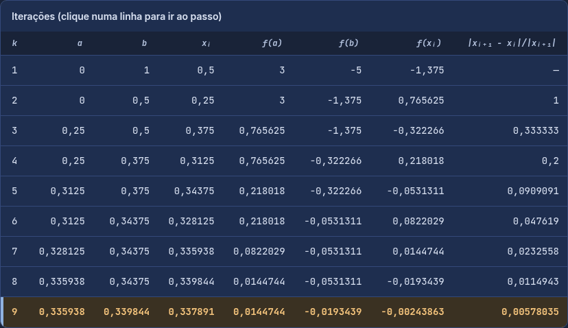

# Métodos Numéricos Interativos

Site interativo para aprender e visualizar, passo a passo, três métodos numéricos clássicos: Bissecção, Newton-Raphson e Eliminação de Gauss.

### 👉 [Abrir o site](https://pedrogmacielalves-prog.github.io/site-metodos-numericos/)

## Métodos

- **Bissecção**: busca de raízes por divisão sucessiva do intervalo [a, b].
- **Newton-Raphson**: busca de raízes usando a derivada a partir de x₀.
- **Eliminação de Gauss**: resolução de sistemas lineares Ax = b.

## Recursos

- Gráficos e animações passo a passo de cada iteração.
- Tabelas de iterações no formato usado em aula.
- Critério de parada relativo (ε, padrão 0,01) ou absoluto.
- Gauss com ordem de 2 a 100, entrada separada de A e b (com opção de colar) e pivoteamento parcial em 3 modos.
- Botão **Ver código**, que mostra o código do método e destaca a linha de cada etapa.
- Botão **Avisos**, com alertas sobre casos especiais (como matriz mal condicionada).
- Layout adaptado para celular.

## Como usar

Acesse o [link do site](https://pedrogmacielalves-prog.github.io/site-metodos-numericos/) ou baixe o repositório e abra o `index.html` no navegador. Não há etapa de build.

## Tecnologias

HTML, CSS e JavaScript puro, sem dependências.
